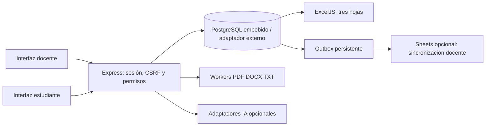

# LectorLab 2.0 — estado de la primera versión

Entrega de una versión funcional para evaluación local con datos ficticios. Continúa el código y contenido existentes; no sustituye una revisión institucional previa al uso con menores ni afirma preparación de producción.

## Recorrido implementado

Docente crea cuenta inicial → grupo y accesos de estudiantes → RED original o lectura propia → revisión de texto/preguntas/citas → publicación inmutable → asignación → estudiante lee y responde → guardado y recuperación → tutor opcional situado → entrega → revisión docente → devolución e insignias privadas → Excel o cola opcional de Sheets.

La producción incluye idea inicial, hipótesis, interpretación, dos evidencias, explicación del vínculo, revisión de hipótesis y reflexión final. Las abiertas no reciben puntos por longitud. La rúbrica humana valora inferencia, evidencia, vínculo y revisión (0–3 por criterio); los hitos se muestran solo cuando existe valoración docente. No hay detectores de IA, rankings ni sanciones automáticas.

## Arquitectura que existe en el código

| Ubicación | Responsabilidad |
|---|---|
| `server.js` | Inicio de plataforma, base persistente, adaptadores opcionales, control de puerto y cierre. |
| `src/platform/app.js` | App construible sin puerto, límites, cabeceras, frontera autenticada y rutas. No monta las APIs anónimas de Etapa A. |
| `db.js`, `schema.sql` | PostgreSQL embebido PGlite o adaptador `pg`, transacciones, restricciones e índices. Lock de instancia y esquema inicial. |
| `auth.js` | Setup único, contraseñas scrypt con sal individual, sesiones opacas almacenadas como hash, expiración, revocación, CSRF y roles. |
| `activities.js`, `seed.js` | Contenido original, claves privadas, evidencia anclada al texto, borradores, publicación y nueva versión por copia. |
| `attempts.js`, `router.js` | Pertenencia, primeras respuestas, guardado, entregas, cálculo objetivo, rúbrica, tutor y consultas docentes. |
| `documents.js`, `generation.js` | Extracción limitada en workers, revisión de texto, generación JSON validada y actualización solo de borradores. |
| `reports.js`, `sheets.js` | Reportes autorizados desde DB, tres hojas, cola persistente, destino por docente y reconciliación por ID. |
| `privacy.js`, `src/ai/openai.js` | Minimización de entrada externa, adaptador real solo en backend, `store:false`, sin reintentos de pago implícitos. |
| `public/platform/` | HTML/CSS/JS modular: acceso, docente, estudiante, lector y cliente de API sin claves. |

Tablas actuales: `users`, `sessions`, `groups`, `enrollments`, `activities`, `assignments`, `attempts`, `tutor_turns`, `assessments`, `documents`, `sync_outbox`, `sheets_connections`, `schema_migrations`.

Esta primera implementación usa JSONB validado para preguntas, respuestas y borrador, con texto/hash y versión de actividad inmutables al publicar. No implementa todavía todas las tablas normalizadas del diseño original ni un historial de cada pulsación o cada borrador intermedio. Se conserva el estado actual, la primera respuesta objetiva y los campos de antes/después, sin presentar eso como prueba absoluta de autoría. La extracción y generación se procesan durante la solicitud con límites; no hay una cola duradera de extracción/OCR.

## Controles comprobables

- Cada operación consulta sesión, rol y propietario o matrícula. IDs del cliente no otorgan acceso. Docente no puede editar respuestas como estudiante ni ver grupos ajenos.
- La vista de estudiante utiliza una lista de campos públicos. No recibe claves, rúbricas privadas ni evidencias de solución de preguntas pendientes. Las rutas/archivos de la demo antigua no se sirven en la plataforma.
- Primeras respuestas objetivas quedan fijadas en transacción. `score`, `correct`, `turn`, historial externo o contadores no gobiernan resultado ni conversación.
- Entrega idempotente: fecha y puntuación objetiva se calculan en servidor y se crea evento de sincronización atómicamente. Las abiertas quedan pendientes del docente.
- Tutor carga lectura, hipótesis y mensajes auténticos del intento; reserva turno bajo lock, no retiene transacción durante la API, deduplica request IDs y limita a cinco intervenciones completadas/pendientes y diez solicitudes técnicas por intento.
- Fallos no consumen turno pedagógico completado. Tras reinicio embebido, pendientes pasan a resultado desconocido; no se repiten automáticamente. Se conserva y muestra la idea sin respuesta confirmada. Una llamada externa no tiene garantía de ejecución exactamente una vez.
- El tutor pide evidencia y vínculo, cuestiona alternativas y cierra en quinto turno. Filtros de formato, citas explícitas, longitud y algunas respuestas resolutivas tienen fallback fijo. No son garantía de que un modelo real nunca revele una respuesta: hace falta evaluación pedagógica real y supervisión.
- Publicar requiere aprobación explícita y cita exacta con offsets Unicode y justificación para cada pregunta. Publicado no admite edición; crear nueva versión conserva intentos anteriores. Un cambio concurrente de lectura invalida una generación antigua.
- TXT UTF-8, PDF textual y DOCX se procesan como texto, sin renderizar HTML activo ni servir originales. Máximo 2 MB, 40 000 caracteres, PDF 80 páginas, dos extracciones simultáneas, worker con deadline de 15 segundos y memoria acotada. DOCX limita expansión/entradas y rechaza macros/recursos externos/cifrado.
- Excel se reconstruye desde DB, incluye el vínculo razonado y mantiene texto como texto. Consolidado minimiza conversaciones por defecto. Un reporte que supere su límite no se entrega truncado silenciosamente.
- Sheets no bloquea entregas: outbox sobrevive reinicios y el reintento usa ID estable. Una hoja está asociada a un solo docente por instalación. No se sobrescriben encabezados ajenos; edición/duplicados detectados requieren corrección. No hay sincronización bidireccional ni garantía universal de ausencia de duplicados ante ediciones externas.

## Privacidad y configuración externa

No existen credenciales predeterminadas ni datos reales en el paquete. Cuentas de estudiantes usan alias y no exigen correo, DNI, fecha de nacimiento, ubicación o biometría. Sesión en cookie HttpOnly y SameSite Strict; Secure en modo producción HTTPS. No se guardan tokens o borradores en `localStorage`. Las respuestas no van a logs. El shell nuevo no carga imágenes/analítica de terceros.

Antes de la API se omiten identificadores de cuenta y se enmascaran por patrón correos, DNI explícito y móviles peruanos. No detecta todos los datos personales ni nombres propios; documentos y mensajes requieren revisión y base institucional. `store:false` no establece retención contractual nula. El aviso de la pantalla no sustituye autorización aplicable, revisión de transferencias ni política de conservación.

No se encontró configuración propia de OpenAI o Google para este proyecto. No se pidieron valores por chat ni se usó la identidad ambiental de Google de la máquina. La versión funciona manualmente y dice claramente cuando IA/Sheets no están configurados. Los dobles de proveedores existen únicamente en pruebas.

## Validación y límites

La evidencia final de comandos y resultados acompaña a esta entrega en `docs/validacion-v2.txt` y `docs/pruebas-v2.txt`. Se probaron PostgreSQL embebido real, reapertura de datos, autenticación HTTP, carreras/transacciones, parsers reales de los tres formatos, Excel real y recorrido completo en Chromium de escritorio y viewport móvil.

No se probaron API real/modelo/facturación, Google real, PostgreSQL externo, Windows, OCR, antivirus externo, multiinstancia, carga de varias aulas, recuperación por correo, accesibilidad con lector de pantalla completo o cumplimiento legal. Esta versión permite crear desde interfaz el primer docente; altas institucionales adicionales requieren una entrega posterior. No hay retención/borrado ni backup automático. Para respaldar, cerrar el proceso y copiar de forma privada la carpeta completa de datos, verificando la restauración antes de uso real.

El override de UUID de Etapa A continúa acotado a ExcelJS y con prueba de compatibilidad; el lockfile fija dependencias. Cero avisos de `npm audit` es una observación del registro, no una certificación de seguridad.

Los commits locales conservan el respaldo original y la Etapa A. Esta versión no se ha subido a GitHub, no se publicó como web y no se comprobó restauración en una tarea nueva. Las instrucciones de nube se guardan como borrador: para activarlas, revisar/guardar en configuración y publicar el entorno, distinto de publicar una web para estudiantes.
